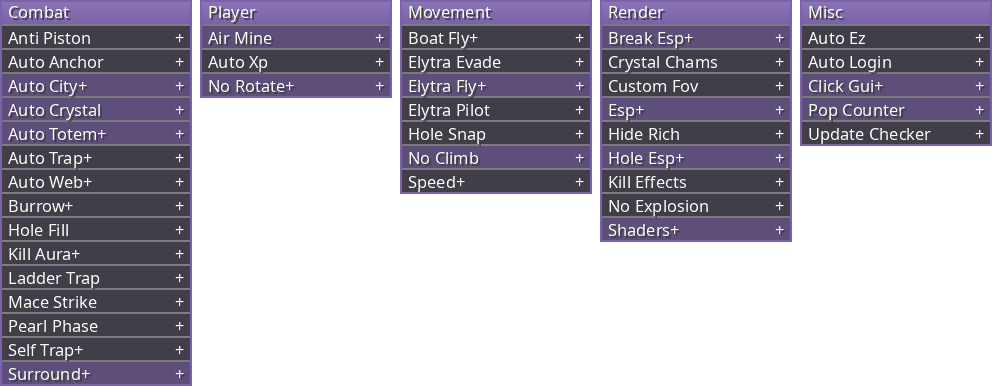

  

Minecraft 1.21.11

  

## Modules

<table>
  <tr>
    <th>Combat</th>
    <th>Player</th>
    <th>Movement</th>
    <th>Render</th>
    <th>Misc</th>
  </tr>
  <tr>
    <td valign="top">AutoCrystal AutoAnchor AutoTotem KillAura MaceStrike Surround AutoTrap AutoWeb AutoCity LadderTrap SelfTrap HoleFill AntiPiston PearlPhase Burrow</td>
    <td valign="top">AirMine AutoXp NoRotate</td>
    <td valign="top">ElytraFly ElytraPilot ElytraEvade BoatFly HoleSnap SpeedPlus NoClimb</td>
    <td valign="top">ESP HoleESP BreakESP Shaders CrystalChams CustomFov KillEffects NoExplosion HideRich</td>
    <td valign="top">ClickGui PopCounter AutoEz AutoLogin UpdateChecker</td>
  </tr>
</table>
